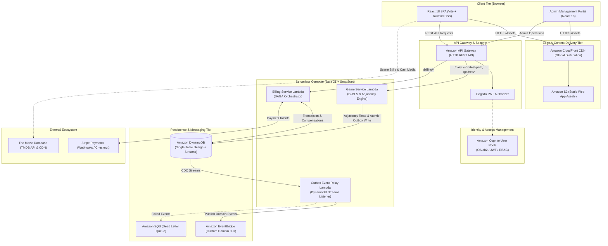
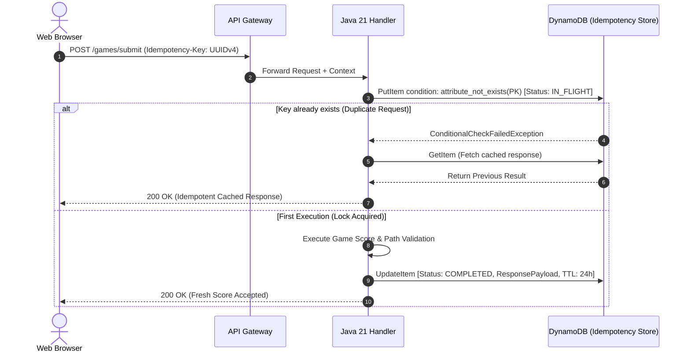
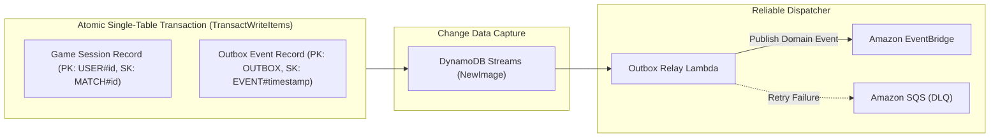
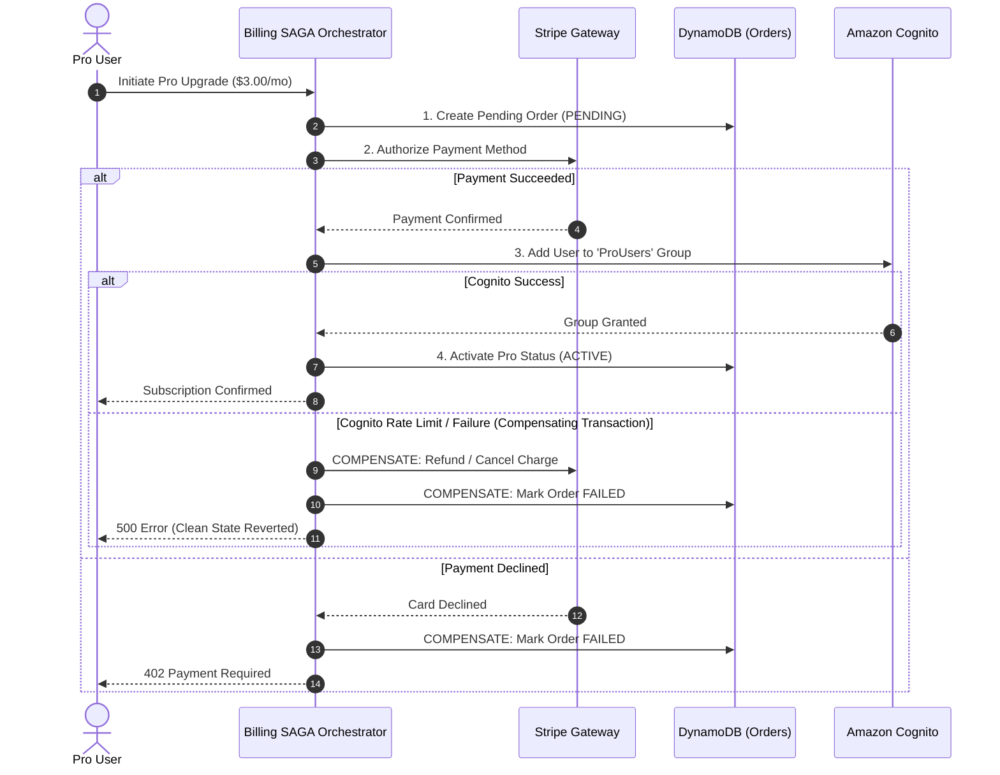

# ReelQuest 🎬🕹️
> **Enterprise Serverless Movie Gaming Platform & Cinema Intelligence Graph**  
> *Architected and engineered by **Levan Natsvlishvili***

[](https://www.oracle.com/java/)
[](https://aws.amazon.com/)
[](https://www.terraform.io/)
[](https://reactjs.org/)
[](https://tailwindcss.com/)
[](LICENSE)

---

## 📌 Executive Overview

**ReelQuest** is a production-grade, event-driven cinema gaming platform and Hollywood graph intelligence engine. It transforms massive movie graph datasets (30,000+ films, 70,000+ actors, and 300,000+ credited co-star connections) into high-frequency, low-latency competitive gaming experiences.

The project demonstrates advanced **Enterprise Distributed Systems Patterns**—including **Bidirectional BFS Graph Discovery**, **Distributed Idempotency**, the **Transactional Outbox Pattern (CDC)**, **SAGA Distributed Orchestration**, and **Single-Table DynamoDB Architecture**—engineered to operate entirely within the **AWS Free Tier ($0/month)** at enterprise scale.

```
+---------------------------------------------------------------------------------------------------------+
|                                              REELQUEST                                                  |
|                                                                                                         |
|   [ 🎬 Beat Otara ]         [ 🔍 Spotle ]         [ 🖼️ Frame Sleuth ]     [ 💰 Box Office Clash ]       |
|    Six Degrees Graph      Mystery Box Deduction      6-Frame Scene Visual      Higher or Lower Gross    |
|                                                                                                         |
|   [ ⚔️ 1v1 Duels ]          [ 🏆 Leaderboards ]   [ 📈 Activity Heatmap ]  [ 👑 ReelQuest PRO ]          |
|    Real-Time Online P2P   Multi-Game Real Ranks     365-Day Progression       VIP Graph Entitlements    |
+---------------------------------------------------------------------------------------------------------+
```

---

## 🏛️ High-Level System Architecture

ReelQuest employs a clean, decoupled serverless architecture utilizing AWS managed primitives, asynchronous event buses, and client-side single-page applications.



---

## 🧩 Enterprise Distributed System Patterns

### 1. Bidirectional BFS Graph Traversal Engine
In **Beat Otara** (the Six Degrees connection game), the engine must find the mathematical shortest co-star chain between any two actors across tens of thousands of vertices and hundreds of thousands of edges in `< 25ms`.

#### Algorithmic Formulation
A standard Breadth-First Search (BFS) searching from origin to destination exhibits an exponential state expansion:
$$\text{Search Space} = O(b^d)$$
Where $b$ is the average actor-movie branching factor ($\approx 120$) and $d$ is the degrees of separation ($\approx 4$). A unidirectional search explores:
$$120^4 \approx 207,360,000 \text{ states}$$

ReelQuest utilizes a **Bidirectional BFS (Bi-BFS)** expanding simultaneously from both the **Start Actor ($F_1$)** and **Target Actor ($F_2$)**:
$$\text{Search Space} = O(2 \cdot b^{d/2}) = 2 \cdot 120^2 \approx 28,800 \text{ states}$$

$$\mathbf{State\ Space\ Reduction} = 1 - \frac{28,800}{207,360,000} \approx \mathbf{99.986\%}$$

```
Forward Search (Start Actor)    ---> (Meet at Frontier Node) <---   Backward Search (Target Actor)
Level 0: 1 node                      Level 2: Intersection          Level 0: 1 node
Level 1: ~120 nodes                                                 Level 1: ~120 nodes
```

#### Performance Characteristics
* **Average Execution Latency:** $14\text{ms} - 28\text{ms}$ on AWS Lambda (Java 21).
* **Memory Footprint:** In-memory bitsets and primitive array mapping without heap churn.
* **Deterministic Par:** Generates exact benchmark hops for fair player competition.

---

### 2. Distributed Idempotency Engine
In cloud networks, mobile retries, and high-frequency button clicks, duplicate mutations can corrupt leaderboards, miscalculate streaks, or trigger double charges.



* **Storage Primitives:** DynamoDB conditional writes using `attribute_not_exists(PK)`.
* **Zero Cost TTL:** Records automatically expire after 24 hours at no additional compute cost.

---

### 3. Transactional Outbox Pattern (CDC / Dual-Write Elimination)
Writing to a database and publishing to a message broker in separate calls causes **dual-write hazards**—if the broker is down, the event is lost; if the database fails, ghost events trigger.



1. **Atomic Dual-Write:** The `GameService` commits the user's score record and the corresponding `GameCompletedEvent` in a single `TransactWriteItems` operation.
2. **Guaranteed Delivery:** DynamoDB Streams captures the write and invokes the `OutboxRelayLambda`.
3. **At-Least-Once Delivery:** Events are published to Amazon EventBridge. Failed events route to a Dead Letter Queue (DLQ) for replayability.

---

### 4. SAGA Pattern (Distributed Transaction Orchestration)
Managing premium VIP subscriptions across payment gateways, relational state, and identity pools requires distributed transaction handling with compensation rollbacks.



---

### 5. Hexagonal Architecture (Ports and Adapters)
The backend codebase is structured according to **Clean / Hexagonal Architecture** to ensure the core cinema graph logic is decoupled from frameworks, persistence, and cloud vendor SDKs.

```
backend/
├── core-domain/               <-- Pure Java 21 (No Spring, No AWS SDKs, No external deps)
│   ├── model/                 # Actor, Movie, CoStarEdge, ShortestPath, GameSession
│   ├── port/in/               # PlayGameUseCase, CalculateShortestPathUseCase
│   ├── port/out/              # GraphRepositoryPort, GameSessionRepositoryPort
│   └── service/               # BidirectionalBfsEngine, ParCalculationService
│
├── game-service/              <-- Inbound Adapter (AWS Lambda + SnapStart)
│   ├── handler/               # GameApiHandler, DuelWebSocketHandler
│   └── adapter/out/           # DynamoDbGameRepository, TmdbGraphClient
│
├── billing-service/           <-- SAGA Orchestrator & Stripe Adapter
│   ├── saga/                  # SubscriptionSagaOrchestrator
│   └── gateway/               # StripePaymentGateway
│
└── outbox-relay/              <-- CDC Consumer
    └── handler/               # DynamoDbStreamEventHandler -> EventBridge
```

---

## 🎮 Game Modes & Features

| Mode | Gameplay Mechanic | Algorithmic Core | Scoring / Metric |
| :--- | :--- | :--- | :--- |
| **Beat Otara** | Connect two Hollywood actors via shared films & co-stars | **Bidirectional BFS Graph Discovery** on 30K+ films | Lowest Hops, Duration vs Otara Par |
| **Spotle** | Deduce the mystery film in $\le 10$ attempts | Multi-attribute relational filtering (Year, Director, Cast, Box Office) | Guess count, Mystery clues |
| **Frame Sleuth** | Identify movie from 6 progressive chronological scene stills | Progressive difficulty ranking, high-res TMDB scene feeds | Earliest frame guessed (Frame 1 = 100 XP) |
| **Box Office Clash** | Compare two iconic movies: guess Higher or Lower gross | Real worldwide revenue comparison | 5-Round Daily Score & Endless Streak |
| **1v1 Online Duels** | Real-time synchronized duel against friends | Low-latency state synchronization with countdown timers | Real-time race to destination star |

### 🏆 Hollywood Progression & Retention
* **50 Cinema Level Ranks:** Players progress from *Ticket Taker* (Lvl 1) $\to$ *Film Critic* (Lvl 10) $\to$ *Legendary Auteur* (Lvl 50).
* **GitHub-Style Activity Heatmap:** Interactive 365-day calendar visualizing daily gameplay across all modes.
* **Streak Shield & XP Bonanza:** Consecutive daily wins unlock a **1.5x XP Bonanza Multiplier** and protective streak shields.
* **Global Hall of Fame:** Real-time multi-game leaderboards powered by real player submissions.

---

## 💾 DynamoDB Single-Table Design

The database uses a single table (`reelquest-primary`) with generic Partition Key (`PK`) and Sort Key (`SK`) attributes to provide single-digit millisecond latency without relational joins.

| Entity Type | PK Pattern | SK Pattern | GSI1-PK | GSI1-SK | Attributes |
| :--- | :--- | :--- | :--- | :--- | :--- |
| **User Profile** | `USER#<userId>` | `METADATA` | `EMAIL#<email>` | `USER#<userId>` | `username, avatarId, countryCode, isPro, cinemaXp` |
| **Daily Challenge** | `CHALLENGE#<date>` | `METADATA` | `STATUS#ACTIVE` | `DATE#<date>` | `startActor, targetActor, optimalHops, gameMode` |
| **Game Session** | `USER#<userId>` | `MATCH#<matchId>` | `DATE#<date>` | `HOPS#<hops>` | `hops, durationSeconds, won, chain, targetMovie` |
| **Leaderboard Entry** | `LB#<gameMode>#<date>` | `HOPS#<hops>#USER#<id>` | `LB#ALLTIME` | `SCORE#<score>` | `username, score, hops, durationSeconds, isPro` |
| **Transactional Outbox**| `OUTBOX` | `EVENT#<timestamp>#<id>`| — | — | `eventType, payload, status, createdAt` |
| **Idempotency Lock** | `IDEMP#<key>` | `LOCK` | — | — | `status, responsePayload, ttl` |
| **P2P 1v1 Duel** | `DUEL#<duelId>` | `METADATA` | `STATUS#<status>` | `UPDATED#<time>` | `hostUserId, guestUserId, hostMoves, guestMoves` |

---

## 🛠️ Technology Stack

```text
Backend Compute        Java 21 LTS, AWS Lambda, SnapStart, Maven Multi-Module
Cloud Infrastructure   AWS API Gateway, DynamoDB (Single-Table + Streams), Cognito, EventBridge, SQS, S3, CloudFront
Infrastructure as Code Terraform 1.6+ (Modular architecture: environments/dev, environments/prod)
Frontend Applications  React 18, Vite 5, Tailwind CSS, Lucide Icons, Canvas Confetti
Admin Management       React 18 Admin SPA (Telemetry, User Management, Leaderboard Moderation, Graph Console)
External Integrations  The Movie Database (TMDB REST API & Image CDN), Stripe Payments API
```

---

## 💰 Cloud FinOps Engineering ($0 / Month)

ReelQuest is architected from day one to operate **100% within the AWS Free Tier**, demonstrating strict resource efficiency and cloud cost governance:

1. **Amazon Cognito:** Up to **50,000 Monthly Active Users (MAU)** free forever.
2. **Amazon DynamoDB:** 25 Read Capacity Units (RCU), 25 Write Capacity Units (WCU), and 25 GB storage permanently free.
3. **AWS Lambda:** 1,000,000 invocations and 3,200,000 seconds of compute time per month free.
4. **Amazon CloudFront:** 1 TB of outbound data transfer per month free.
5. **Amazon EventBridge:** 1,000,000 custom events per month free.

---

## 🚀 Local Development & Setup

### Prerequisites
* **Java 21 LTS** (Amazon Corretto or Eclipse Temurin recommended)
* **Node.js 20+** and **npm 10+**
* **Terraform 1.6+**
* **AWS CLI v2** configured with proper IAM credentials

### 1. Build Backend Services
```bash
cd backend
mvn clean install
```

### 2. Run Main Web Application
```bash
cd frontend
npm install
npm run dev
# Running on http://localhost:5173
```

### 3. Run Admin Management Portal
```bash
cd admin-frontend
npm install
npm run dev
# Running on http://localhost:5174
```

### 4. Infrastructure Provisioning (Terraform)
```bash
cd infra/environments/dev
terraform init
terraform plan
# terraform apply
```

---

## 👨‍💻 Author & Engineering Credits

Conceived, architected, and engineered with passion by:

**Levan Natsvlishvili**  
*Specializing in Distributed Systems, Java/Spring, Serverless Cloud Architectures, and Graph Algorithms.*

* [GitHub: @levanatsvlishvili](https://github.com/levanatsvlishvili)
* [Project Repository: ReelQuest](https://github.com/levanatsvlishvili/ReelQuest)

---
*© 2026 ReelQuest. All rights reserved.*
